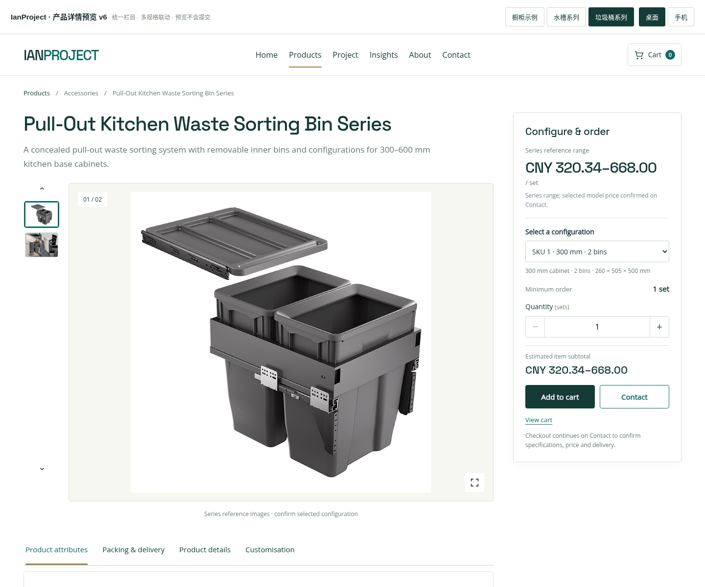
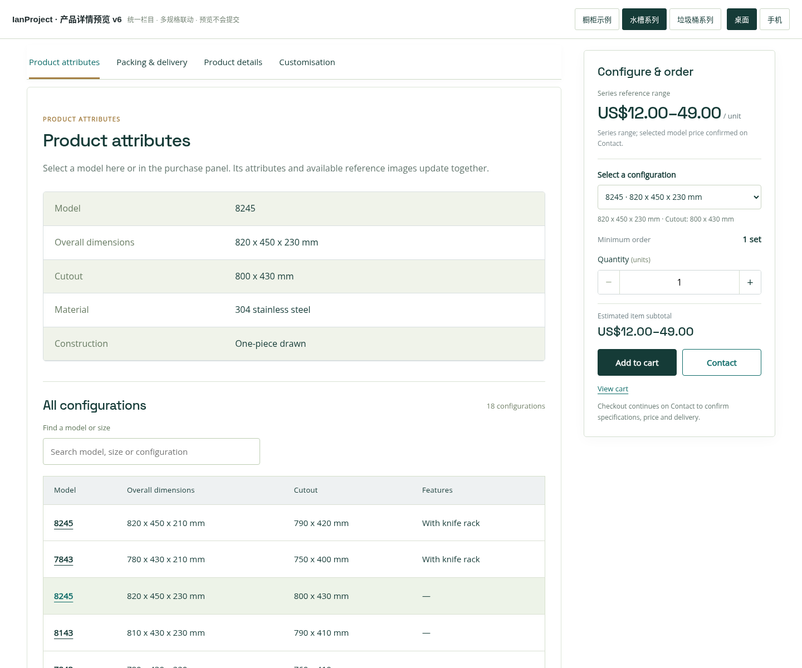
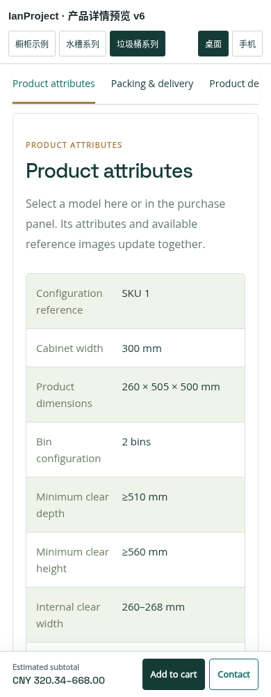

# IanProject 产品详情预览 v6 — 统一栏目与多规格联动

已按确认的结构更新独立交互预览：商品属性 → 包装与交付 → 商品详情 → 定制说明 → 其他产品推荐。沿用全站的深青绿、浅米色和金色细节，保留 4:3 产品图、详情长图及右侧采购栏。

## 打开

下载 `ianproject-product-layout-preview-v6.zip`，解压后用 Chrome / Edge 打开 `index.html`。图片和字体已内嵌，支持离线查看。顶部可切换橱柜、水槽、垃圾桶及手机布局。

## 多规格示例

| 示例 | 配置 | 行为 |
|---|---|---|
| 橱柜 | 单一产品、按米计价 | 完整图库、产品属性及定制资料 |
| 水槽 | 18 个配置 | 右侧选择或点击规格表，更新对应参考图、尺寸、开孔及参数 |
| 垃圾桶 | 14 个配置 | 更新柜宽、桶数、容量、安装净尺寸、滑轨与配件信息 |

同型号不同尺寸按独立配置处理，避免在购物车中错误合并。购物车图片取自所选配置，而不是始终使用产品第一张图片。Contact 带入具体配置、尺寸、数量、目的地和参考金额。

## 图片、价格与包装数据

- 使用原站已有资料，不生成或改写产品照片。
- 水槽按目录分组绑定参考图片，相同外形配置可以共用图片；垃圾桶部分配置暂无单独实拍，明确显示为系列参考图片。
- 水槽原资料只有 US$12–49 / unit 的系列区间价；垃圾桶只有 CNY 320.34–668 / set 的系列参考价。没有将最低价冒充某个型号的确定价格。
- 已实现型号价格覆盖和型号包装信息覆盖。为某个配置提供真实独立价格、装箱量、包装尺寸及重量后，界面会优先使用该配置资料。
- 当前未提供的包装信息显示简洁的待确认说明，不填造假尺寸或重量。
- 不同币种分别计算、分别列出，不做隐含汇率换算。

## 页面结构

1. 商品属性：当前配置属性及可搜索的完整规格表。
2. 包装与交付：配置包装资料、起订量、交期、EXW / FOB / CIF / DDP 和目的地。
3. 商品详情：特点、大图、细节图；手机自动纵向排列。
4. 定制说明：可定制项目、图纸及材料清单要求。
5. 其他产品推荐：放在底部，不占用详情导航位置。

## WooCommerce 对应方案

这是独立前端预览，没有写入 WordPress 或 WooCommerce，也没有删除插件。正式整合时采用 WooCommerce 原生可变商品：每个可采购配置使用独立 variation ID 和 SKU，绑定价格、属性及图片；包装字段、规格图库和页面排版由主题呈现。不同尺寸不只用重复的型号代码作为唯一标识。

当前清单只保存在预览页面内，刷新页面会重置。结算进入 Contact 预览，Review request 仅生成当前页面文字摘要，不发送、不收款、不创建订单。

## 验证

53 项检查通过，涵盖三类商品在 320–1440 像素的布局、统一栏目、型号图片与参数联动、同代码不同尺寸分开入车、参考价计算、多币种合计、型号价格和包装覆盖、Contact 数据带入及手机操作。没有向外发送客户请求。

这不是 WordPress 安装包。

## 截图

### 水槽：当前配置与右侧采购栏

### 垃圾桶：规格选择与系列参考图

### 商品属性与规格表

### 包装与交付

### 联系页保留具体配置与币种

### 手机商品属性

