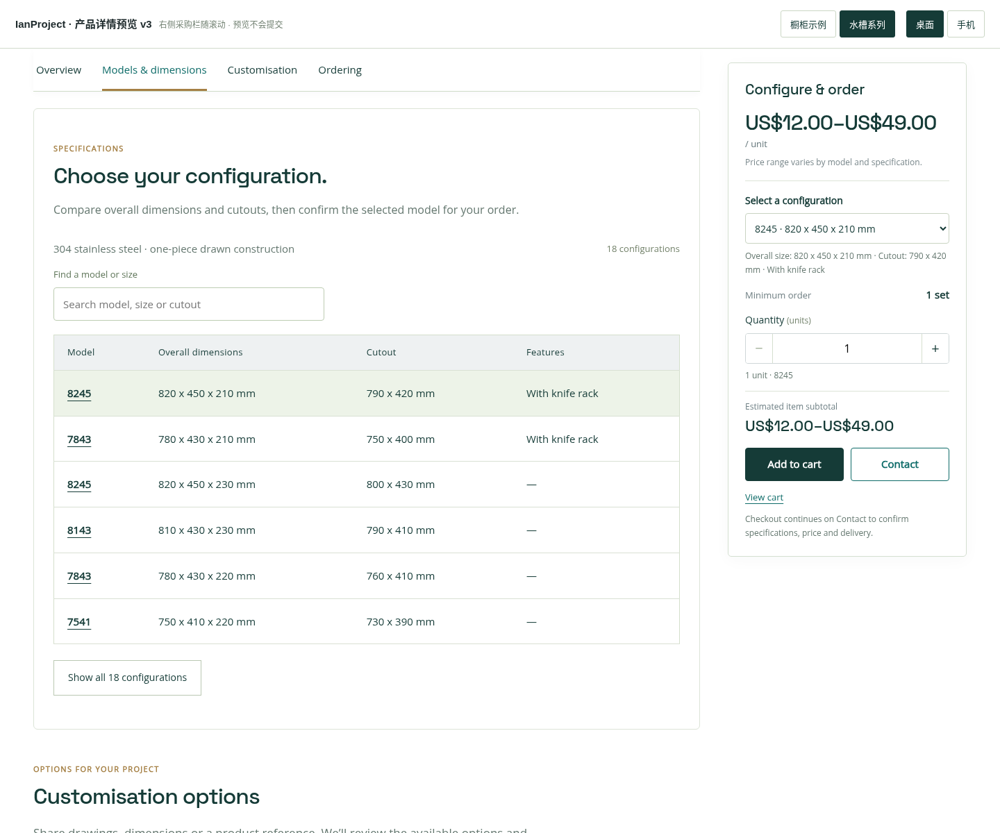
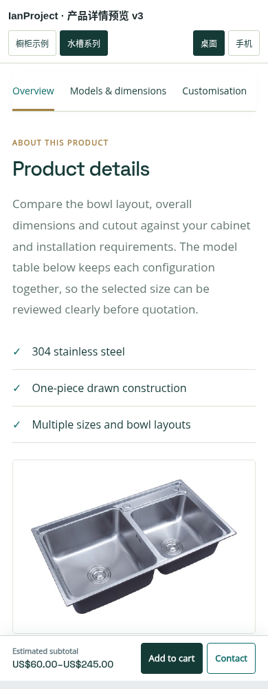

# IanProject 产品详情预览 v3

新版使用其他页面已有的深青绿、浅米色和金色点缀，保留电商式信息组织方式。仅供排版与交互预览，没有修改线上网站、主题或插件。

## 打开预览

下载 `ianproject-product-layout-preview-v3.zip`，解压后用 Chrome / Edge 打开 `index.html`。图片和字体已内嵌，可离线查看。顶部切换橱柜、水槽以及电脑、手机布局。

## 本次改动

- 左侧为连续产品内容：标题、统一缩略图库、大图、介绍、规格、定制和交付说明。
- 右侧集中价格、型号、数量、小计和采购操作。浏览左侧详情时保持可见，到详情末尾停止，不遮住推荐产品及页尾。
- 右侧没有独立滚动条。若屏幕高度不足以容纳整个采购栏，采购栏随页面自然滚动，保证所有选项可用。
- 手机端按顺序展示产品介绍、图库、采购选项和详情，底部显示预估金额、Add to cart 与 Contact。
- Add to cart 可积累多个商品；Contact 带入当前型号和数量，并保留购物车中的其他商品。同一型号不会因为点击 Contact 而重复增加数量。
- 购物车结算进入 Contact 预览，自动带入产品、型号、数量、目的地和参考金额。Review request 仅在当前页面生成文字摘要，不发送、不收款、不创建订单。

## 与现有网站配色统一

| 用途 | 颜色 |
|---|---|
| 标题、主按钮 | `#153b37` |
| 链接、悬停及选中状态 | `#0d6b68` |
| 浅色区块、表格及选中背景 | `#f0f3ea` |
| 金色细节及导航下划线 | `#a58045` |

## 参考价格

使用原站资料，不包含虚构折扣：橱柜 From US$638 / metre，水槽 US$12–49 / unit。橱柜按米数计算起价预估，水槽按件数计算区间。运费、税费及最终定制差价在联系后确认。产品示例的 MOQ 仍采用原资料，不把按米估算当成已确认的采购订单。

正式整合主题时，产品资料、图库、价格、属性和购物车应继续由 WooCommerce 管理；这份文件不是 WordPress 安装包。

## 验证

已完成图库、放大、型号选择及筛选检查，30 项购物车和联系流程检查，以及 29 项采购栏滚动定位、末尾停止、主题配色、Contact 数据和 320–1440 像素布局检查。

## 页面截图

### 橱柜首屏

### 水槽首屏

### 浏览规格时的右侧采购栏

### 手机底部价格与操作

