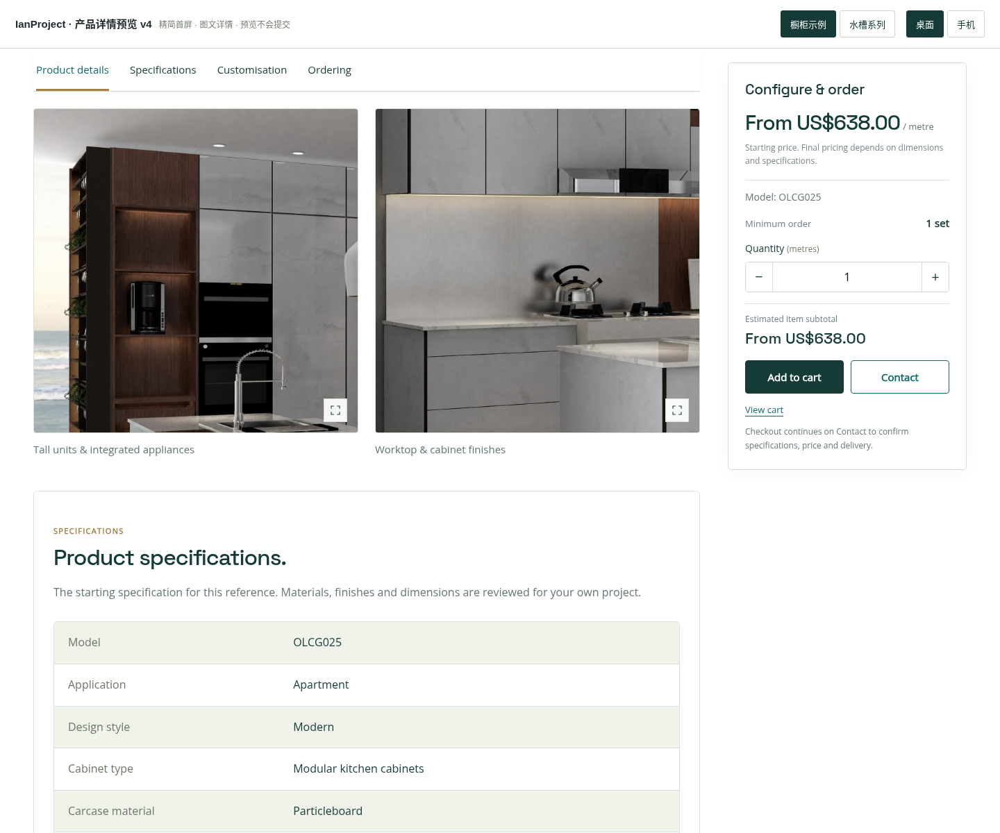

# IanProject 产品详情预览 v4

本次精简产品首屏，并明确安排下方详情图片。保留上一版深青绿、浅米色、金色细节和右侧随滚动的采购栏。仅供预览，没有修改线上网站或安装的主题、插件。

## 打开

下载 `ianproject-product-layout-preview-v4.zip`，解压后用 Chrome / Edge 打开 `index.html`。字体与图片已经内嵌，可离线查看。顶部可切换橱柜、水槽、电脑和手机布局。

## 去掉重复信息

- 删除标题上方的分类、型号行。
- 删除标题与图库之间的参数条。
- 分类由面包屑表达，当前型号在右侧采购栏保留，完整参数在规格区统一展示。
- 首屏保留产品名、简述、大图库和采购选项。

## 详情图片位置

页面顺序：首屏图库 → 产品详情（文字和特点、大图、两张细节图）→ 规格 → 定制 → 交付说明。

详情图在左侧正文区展示，电脑上第一张大图铺满正文宽度，后两张并排；手机上全部纵向排列。图片保留完整比例，可以点击放大。右侧采购栏覆盖图文详情及规格区域，到详情末尾停止。

当前使用原站已有图片演示：橱柜展示开放式收纳、高柜及台面细节，水槽展示不同盆型。正式整合时，计划让顶部产品图库和下方详情图文分别在 WooCommerce 中编辑；下方可加入长图、尺寸图、材质图和安装图，不要求重复使用顶部图库。

## 保留交互

支持原资料参考价、数量小计、多产品购物车、型号选择及筛选。Contact 会带入当前型号、数量及购物车中的其他商品；结算进入联系页预览，Review request 仅生成当前页面内的摘要，不提交询价、不收款、不创建订单。

## 验证

购物车和联系流程 30 项、右侧采购栏及手机适配 29 项、首屏精简与详情图库 17 项检查通过。检查包含图片放大、手机单列、桌面双列、首图选择不受详情图放大影响，以及 320–1440 像素布局。

本文件不是 WordPress 安装包。

## 页面截图

### 精简后的首屏

### 产品详情大图

### 并排细节图

### 手机底部采购操作

