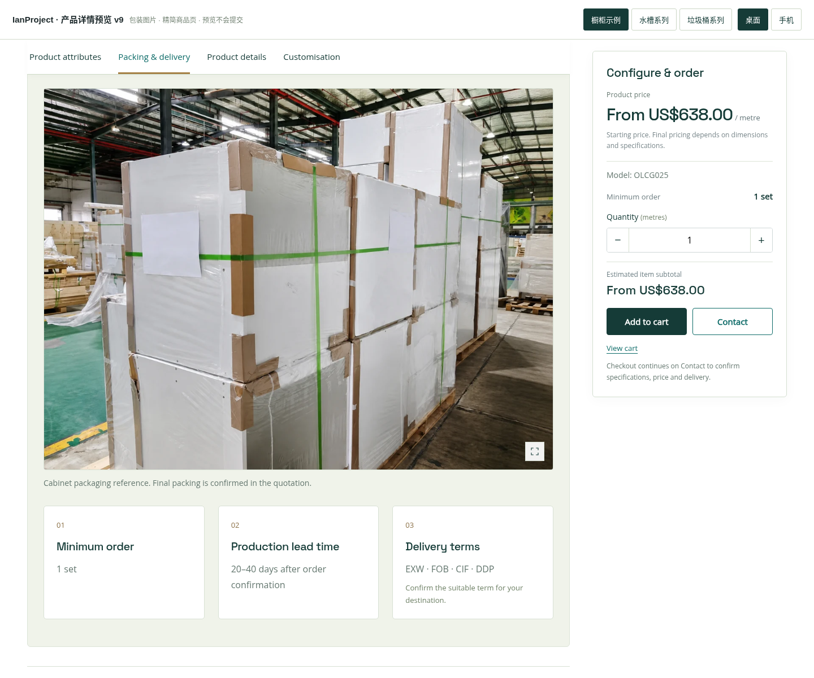
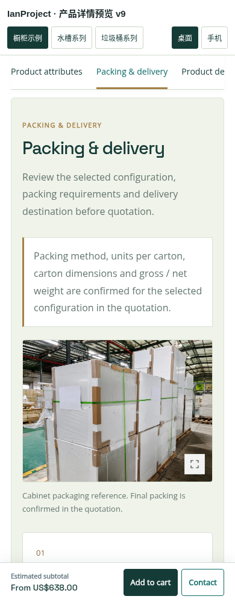

# IanProject 产品预览 v9

商品页“包装与交付”中的目的地输入框已删除。国家只在 Contact 页填写，商品页不再重复收集。

包装部分增加单张可放大的图片。橱柜示例使用原站包装指南中已有的保护包装照片；水槽和垃圾桶尚未提供对应包装照片，预览不会套用橱柜照片。图片数据支持商品默认图和配置专属图；正式整合时可为各商品、各配置分别设置。

下载 `ianproject-product-layout-preview-v9.zip`，解压后打开 `index.html`。字体和图片已内嵌，可离线查看。其余栏目、型号联动、购物车及单列详情大图沿用上一版。

当前为独立交互预览，没有修改线上主题、商品数据或插件，不是 WordPress 安装包；Contact 预览不会发送询价。

