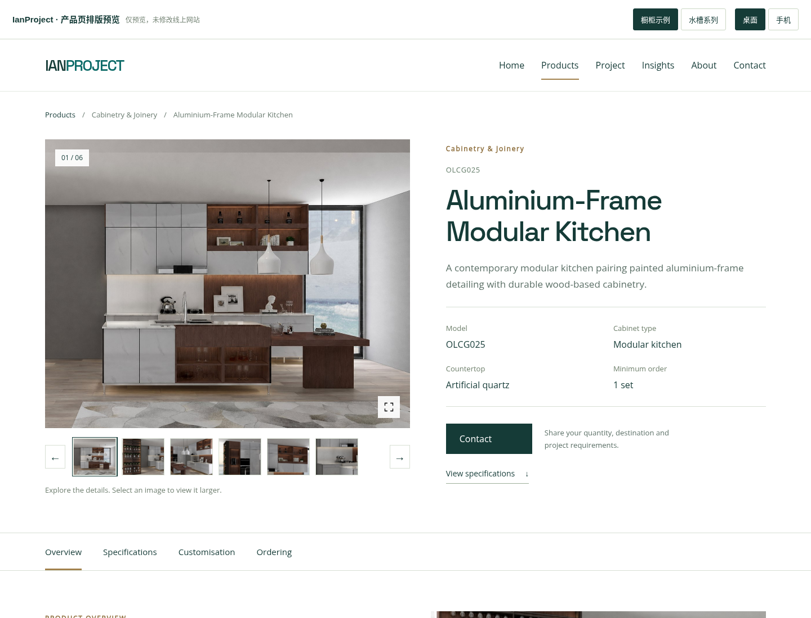
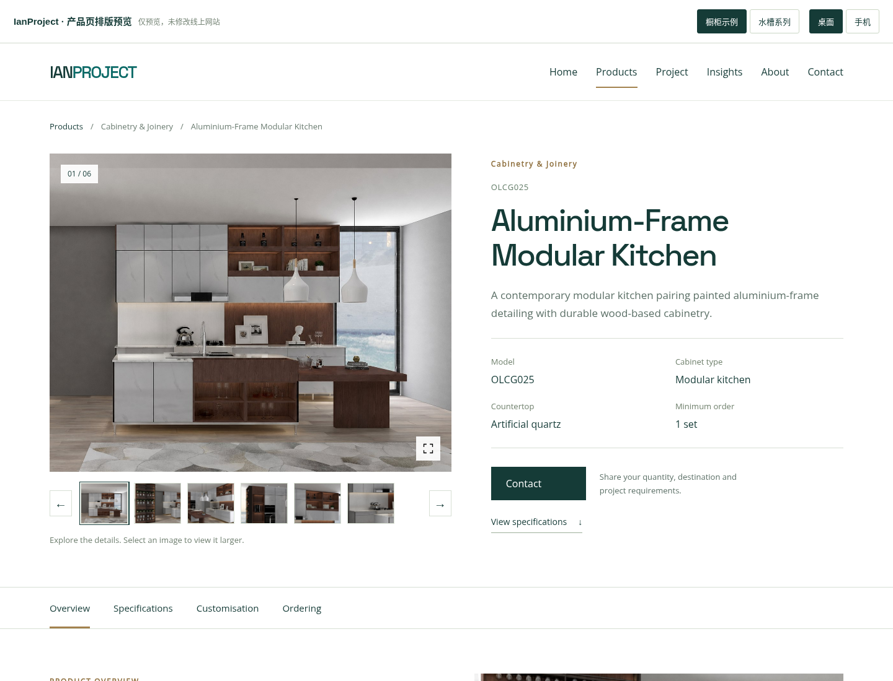
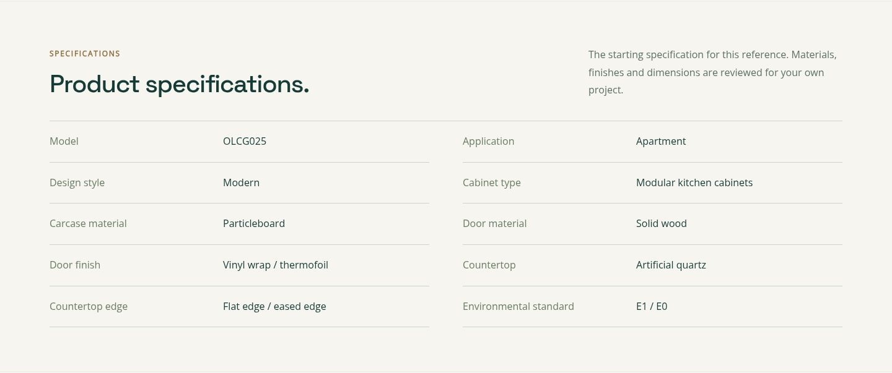

# IanProject 产品详情统一排版 · 预览 v1

这是独立的交互预览，不是 WordPress 安装包。没有修改线上站点，没有停用或删除插件。

## 打开预览

下载 `ianproject-product-layout-preview-v1.zip`，解压后，用 Chrome 或 Edge 打开 `index.html`。页面不需要联网加载字体或图片。

顶部可切换“橱柜示例 / 水槽系列”和“桌面 / 手机”。缩略图、上一张 / 下一张、图片放大、型号选择和型号表展开均可操作。

预览中的 Contact、导航与相关产品链接会打开现有网站；预览本身不发送询价、不保存客户数据。产品资料取自原站数据，用于比较两类产品的排版；正式接入时应读取当前 WooCommerce 中的资料。

## 统一结构

- 左侧大图与固定尺寸缩略图；右侧产品名称、简述、关键参数与 Contact。
- 产品介绍、参数 / 型号、定制选项、采购信息、同类产品和底部 Contact。
- 白底产品图通过页面显示范围去除多余留白，原图片文件不修改。场景图与白底图共用一致的图库框架。
- 不展示购物车、支付、目录索取或重复的报价标题。

## 自制产品插件能否删除

可以在正式改版中取消这个独立插件，但目前不要直接删除。

推荐结构为 **WooCommerce + IanProject 主题**：

| 内容 | 保留位置 |
|---|---|
| 产品、分类、SKU、属性、主图、图库、描述 | WooCommerce 原生数据 |
| 统一产品模板、缩略图、型号展示 | IanProject 主题 |
| 产品筛选、分类隐藏、只询价显示 | 从自制插件迁入主题，沿用现有设置 |
| 旧产品迁移与兼容 | 确认迁移完成并保留备份后处理依赖 |

完成迁移和验证后，才停用并删除自制 IanProject 产品目录插件。WooCommerce 继续保留。换主题不会主动删除 WooCommerce 产品，但当前主题提供的特殊展示和目录控制需由新主题接续。

## 橱柜首屏

## 水槽首屏

## 型号表

