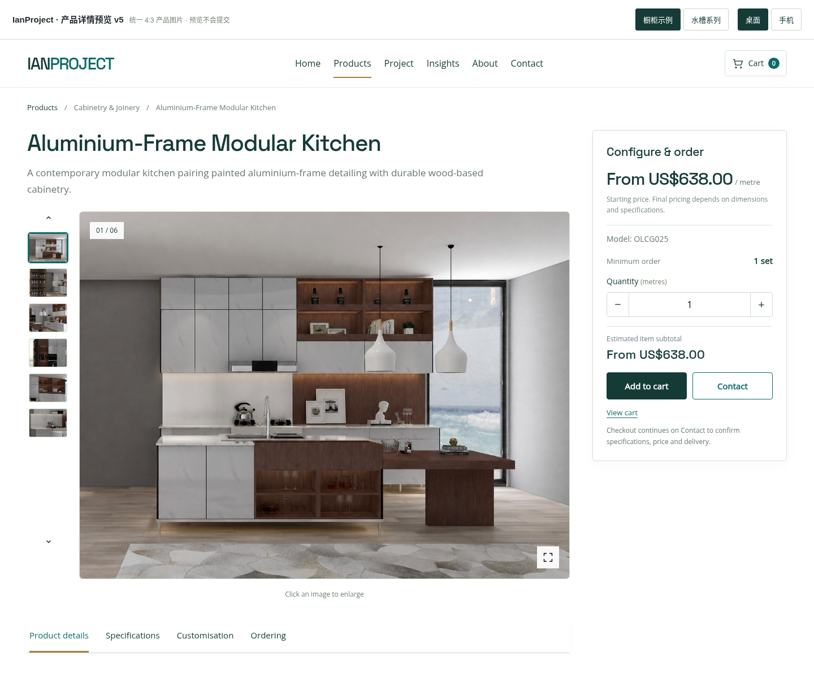
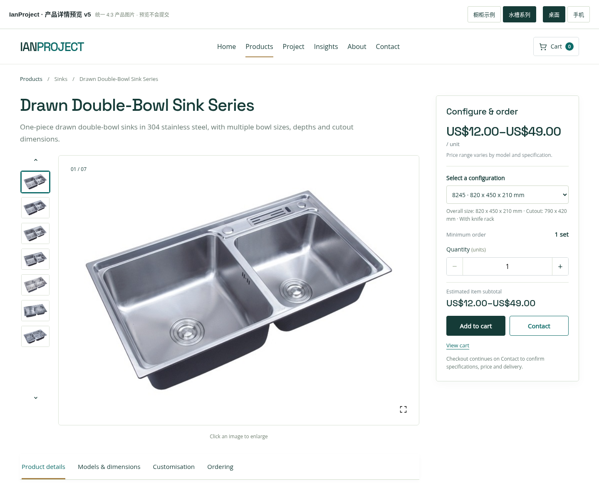
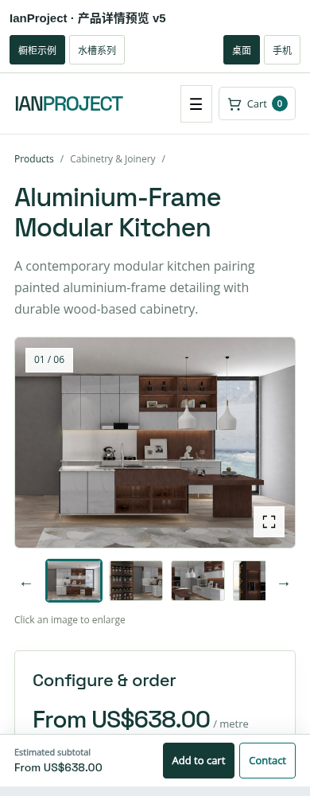

# IanProject 产品详情预览 v5 — 统一图片比例

主图和缩略图统一为 4:3 横图显示，去掉场景大图的左右灰边。保留现有网站的深青绿、浅米色和金色细节，以及右侧随滚动的采购栏。

## 打开

下载 `ianproject-product-layout-preview-v5.zip`，解压后用 Chrome / Edge 打开 `index.html`。字体和图片已内嵌，可离线查看。顶部切换橱柜、水槽、电脑和手机。

## 图片处理规则

- 主图：统一 4:3 展示，后续准备图片建议采用 1200 × 900 像素。
- 缩略图：同样使用 4:3。切换图片时主图画框尺寸不变。
- 场景图：以产品主体为中心填满画框，减少无关的天花板和地面，并去掉两侧灰边。
- 白底产品图：等比置于统一画框，保留产品完整轮廓。水槽示例优先使用原资料中的原始目录图片。
- 点击大图：打开较大的看图窗口，完整显示原图。
- 下方图文详情：保留原图比例，便于尺寸图、安装图和长图完整展示。

当前通过页面布局统一显示尺寸，原始图片文件没有被重写、拉伸或生成替换。后续上传图片可按统一尺寸准备，再进入同一模板。

## 其他内容

首屏已精简重复分类和参数，详情区保留一张大图及两张细节图。价格、型号、数量、小计、购物车和 Contact 数据带入保持可用。结算进入联系页预览，不收款、不创建订单、不发送询价。

完成 48 项图片比例、缩略图、原图放大、白底轮廓及 320–1440 像素布局检查；采购栏定位、详情末尾停止和手机操作的 29 项检查通过。

仅供交互预览，没有修改线上网站、主题或插件；这不是 WordPress 安装包。

## 页面截图

### 橱柜：统一横图，填满画框

### 水槽：统一画框，保留完整产品轮廓

### 手机：主图与缩略图统一比例

