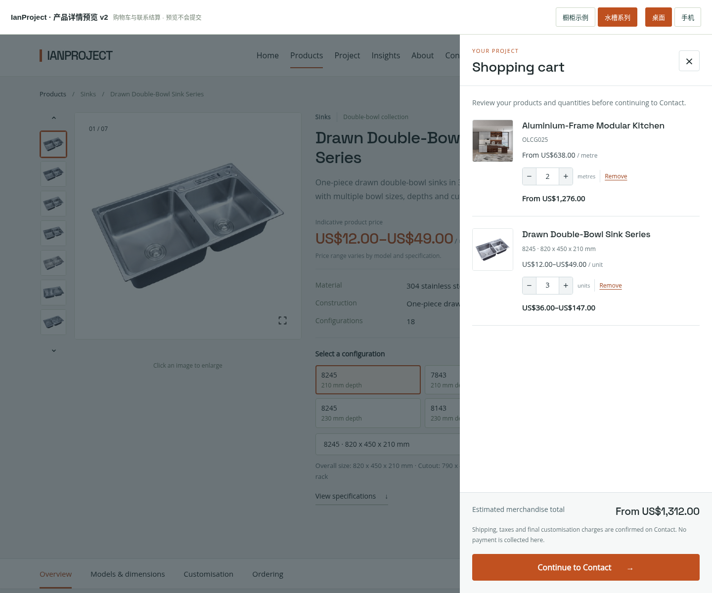
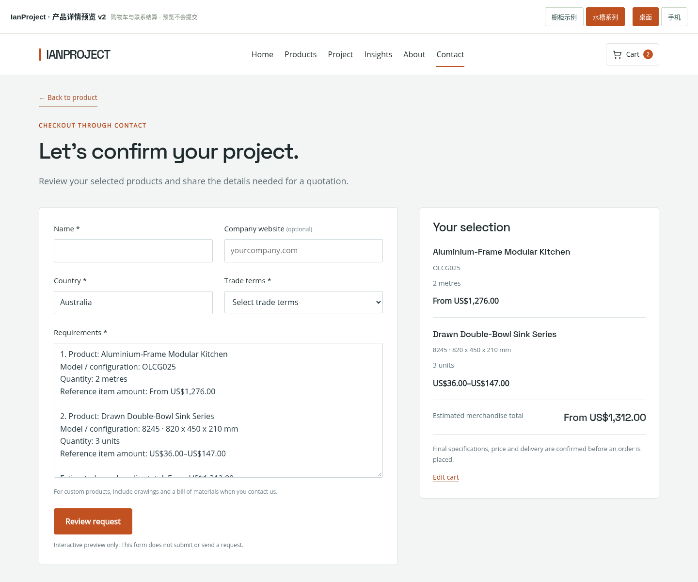

# IanProject 产品详情预览 v2 — 电商式布局与购物车

这是独立交互预览，不是 WordPress 安装包。没有修改线上网站、主题或插件，也不会收款、创建订单或提交询价。

## 打开

下载 `ianproject-product-layout-preview-v2.zip`，解压后用 Chrome / Edge 打开 `index.html`。字体与图片已内嵌，可以离线查看。

顶部切换“橱柜 / 水槽”“桌面 / 手机”。试着选择型号、填写数量与目的地，点击 Add to cart，再从购物车进入 Contact。

## 这一版

- 参考大型电商的信息层级：竖排缩略图、大图、产品参数、采购卡片组成三栏首屏。
- 品牌视觉改为深灰、白底和暖橙色操作按钮，详情区采用更紧凑的分区。
- 橱柜和水槽共用模板；水槽提供型号快捷选择及可搜索的完整配置表。
- 购物车支持多个产品、不同配置、修改数量及移除商品；切换两个示例时保留清单。
- 结算进入联系页预览，带入商品、型号、数量、目的地和参考金额。联系表单保留名字、公司网址、国家、EXW / FOB / CIF / DDP、Requirements。
- 联系页的 Review request 只生成页面内的摘要，不发送或保存客户资料。

## 价格与计价单位

使用原站资料中的参考价，没有虚构折扣或具体型号价格：

| 示例 | 原资料价格 | 购物车处理 |
|---|---|---|
| Aluminium-Frame Modular Kitchen | From US$638 / metre | 按填写的米数计算“起价”预估值；MOQ 资料仍为 1 set，具体项目配置需确认 |
| Drawn Double-Bowl Sink Series | US$12–49 / unit | 按件数计算区间，不把某一型号直接当作最低价 |

包含“起价”的混合购物车显示合计起价；只有区间价格时显示合计区间。运费、税费和最终定制差价在联系页确认，不冒充最终付款金额。

产品与价格取自原站快照，仅用于排版示例。正式版应读取当前 WooCommerce 中的价格、计价单位、属性和图库。

## 测试

完成桌面、手机图库与型号交互检查，以及价格计算、跨产品购物车、删除、修改数量、联系页带入和 320–1440 像素布局等 30 项购物车检查。没有向线上网站发送客户资料。

## 页面截图

### 橱柜产品

### 水槽系列

### 多产品购物车

### 联系页结算

