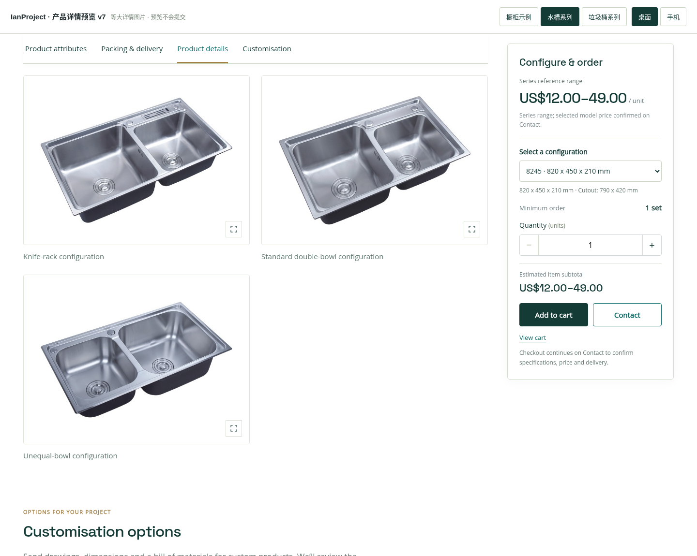
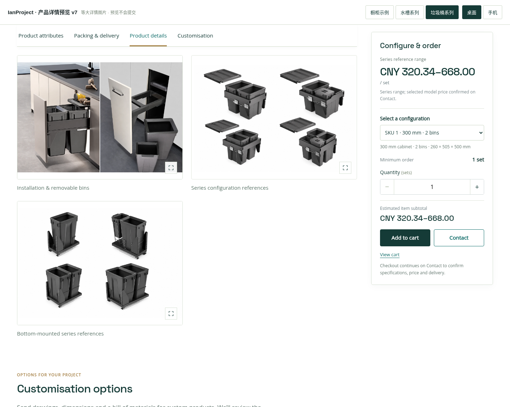

# IanProject 产品预览 v7 — 等大详情图片

Product details 中的图片已改为统一 4:3 展示，不再使用首张大图加两张小图。

- 电脑和平板：两列等大图片。
- 手机：单列等大图片。
- 场景图填满统一画框；白底产品和组合示意图保留完整内容。
- 点击图片仍可查看完整原图，原始图片文件保持不变。

沿用上一版的商品属性、包装与交付、商品详情、定制说明和产品推荐，以及型号联动、价格、购物车和 Contact 预览。顶部可切换橱柜、水槽、垃圾桶。

下载 `ianproject-product-layout-preview-v7.zip`，解压后用 Chrome / Edge 打开 `index.html`。字体和图片已内嵌，可离线查看。

本次检查三类商品在 320–1440 像素下的详情图片尺寸、单双列排列、完整原图放大及采购栏末尾停止。

当前为独立交互预览，没有修改线上网站、主题、插件或 WooCommerce 数据；不是 WordPress 安装包。

## 橱柜详情

## 水槽详情

## 垃圾桶详情

## 手机详情

