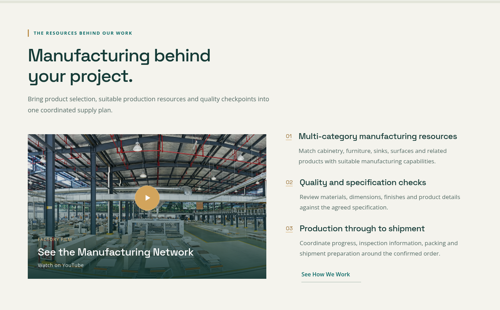
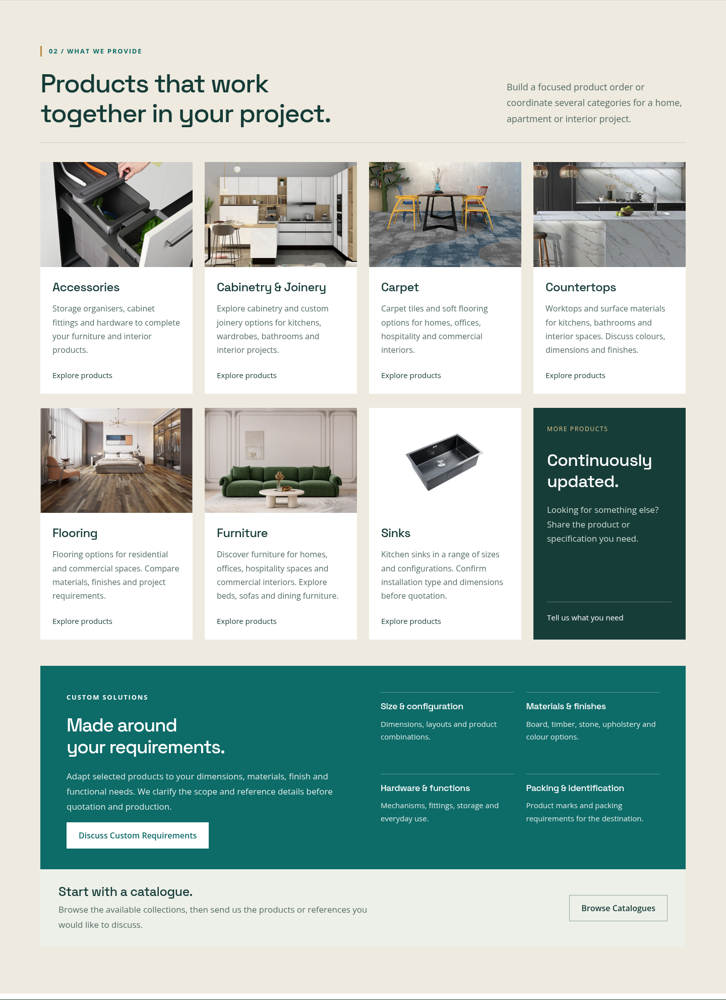
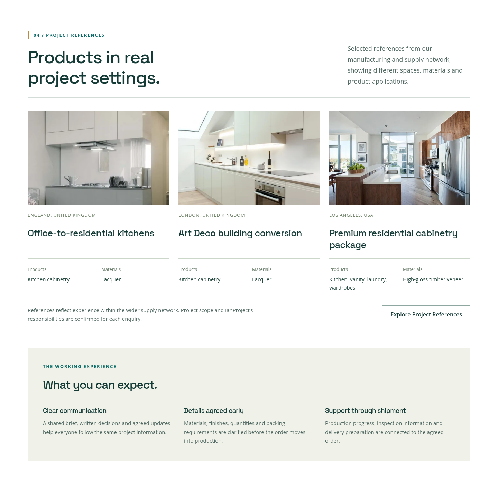
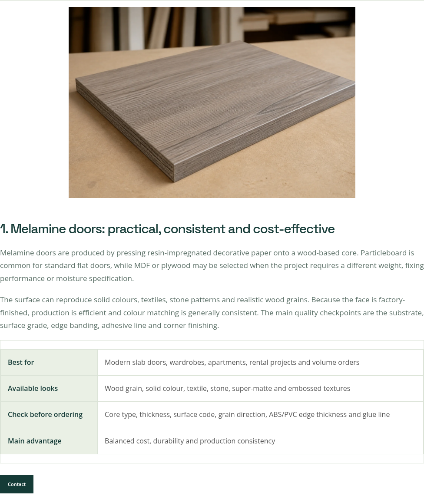

# IanProject 3.0.1 更新包与效果预览

已安装 3.0.0 的站点：覆盖更新主题与产品模块，确认两者已启用，清除缓存。**无需重新导入页面或产品。**

- [主题安装包](ianproject-theme-3.0.1.zip)
- [产品模块安装包](ianproject-catalog-3.0.1.zip)，需 WooCommerce
- [更新说明](UPDATE-3.0.1.md)

打开 ZIP 后，点击右上角 **Download raw file / 下载原始文件**。不要把整个仓库 ZIP 当作主题安装包。

本版统一放大全站字体，修复文章缩图与表格挤压，增加产品模块未启用时的基础显示，并从已有产品元数据补全可显示的型号参数。首页分类空白简介、案例信息对齐和导航箭头也已调整。首页保留目录入口，其余内页的目录索取和配套邮件按钮改为 Contact。

以下为本地测试页面截图；分类封面及内容仍可在后台编辑。没有修改线上站点或导入测试产品到线上。

### 导航

### 工厂介绍

### 产品分类

### 案例

### 文章图片、正文及表格

