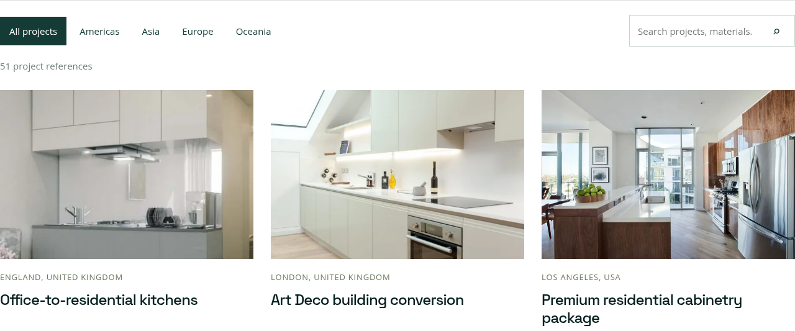

# IanProject 3.0.3 — Project 卡片对齐

仅修复 Project 列表的卡片排版。产品页及产品插件保持原样。

同一行案例卡片共用图片、地区、标题及 Products / Materials 信息的行高。标题或说明换行时，分隔线与信息标题仍对齐，保留全部文字。

已测试 390、768、1024、1440 和 1920 像素宽度，包含额外的长标题、长说明情况；每行信息区的垂直偏差为 0，无横向溢出。

上传 `ianproject-theme-3.0.3.zip`，替换已安装的 IanProject 主题，再清除 LiteSpeed / 主机缓存即可。不需要重新导入页面、文章或产品。产品插件继续使用 3.0.1。

[下载主题安装包](ianproject-theme-3.0.3.zip)。打开 ZIP 后点击右上角 **Download raw file** 保存。

## 修复后的首行

