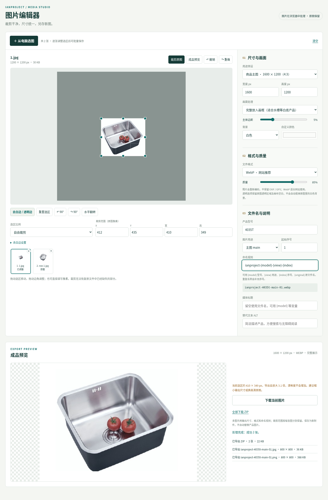

# IanProject 图片编辑器 1.0.0

独立可选 WordPress 插件，也提供无须联网的单文件离线版本。未修改线上网站、main 分支或既有主题。

- [下载 WordPress 插件 ZIP](packages/ianproject-photo-editor-1.0.0.zip)：上传到「插件 → 安装插件」，启用后在「媒体 → IanProject 图片编辑器」使用。
- [下载离线版 ZIP](packages/ianproject-photo-editor-offline-1.0.0.zip)：解压后双击 HTML，从电脑选图并下载结果。
- [完整使用说明](使用说明.md) · [文件校验](SHA256SUMS.txt) · [本地验证](verification.json) · [源代码](source/ianproject-photo-editor)

支持拖动和像素裁剪、去白边、旋转翻转、比例/尺寸预设、WebP/JPEG/PNG、质量和背景、型号/用途/序号命名、标题及 ALT、多图队列、ZIP 和媒体库另存。每张图的裁剪范围单独保存，不覆盖原图，不自动改商品引用。

编辑后的图片是原生媒体附件，插件停用或删除不影响它们。裁剪无法补回原文件里已丢失的产品部分，低分辨率放大也不会产生新细节。

